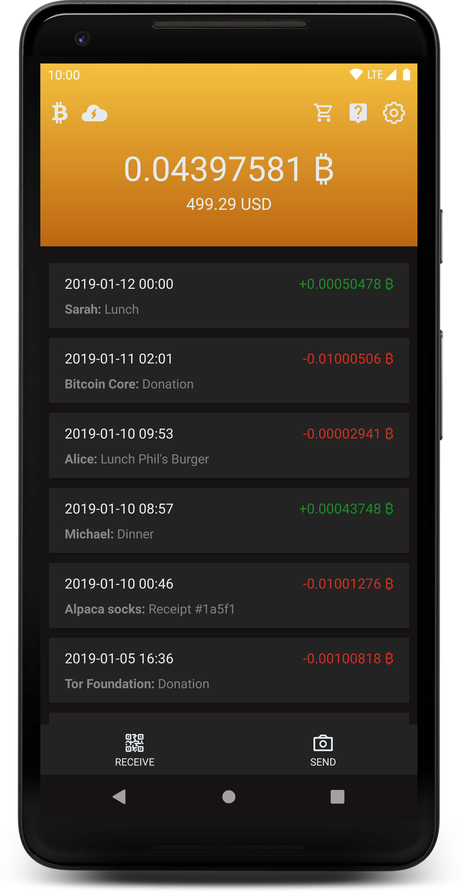

# Blixt Lightning Wallet

<a href="https://play.google.com/apps/testing/com.blixtwallet"></a>&nbsp;
<a href="https://testflight.apple.com/join/EXvGhRzS"></a>&nbsp;
<a href="https://t.me/BlixtWallet"></a>

Blixt Wallet is an open source Lightning Bitcoin Wallet for Android with focus on usability and user experience,
powered by lnd and Neutrino SPV.

<p>
  
</p>

## Features

- [x] Embedded lnd with Neutrino
- [x] Descriptive and clean transaction log
- [x] Receive payments
- [x] Autopilot
- [x] Pincode
- [x] Fingerprint
- [x] Optional Recipient/Sender name that will be displayed on transactions
- [x] Optional "Payer" field for bookkeeping when creating invoice
- [x] Scheduled sync of chain background job
- [x] Local channel backup
- [x] [LNURL](https://github.com/btcontract/lnurl-rfc) support (all sub-protocols: pay, channel, auth and withdraw)
- [x] Channel backup to Google Drive (Android) and iCloud (iOS)
- [x] [WebLN](https://webln.dev/) browser
- [x] Support for [Multi-Part Payments (MPP)](https://lightning.engineering/posts/2020-05-07-mpp/)
- [x] Integrated Tor support
- [x] Sending to Lightning Address
- [ ] Automatically open channels when needed ([LSP](https://github.com/hsjoberg/dunder-lsp))
- [ ] Receiving via Lightning Address by [Lightning Box](https://github.com/hsjoberg/lightning-box)
- [ ] NFC

## Known Bugs

The wallet uses lnd that is young and might have bugs. Check [lnd bug list here](https://github.com/lightningnetwork/lnd/issues?q=is%3Aissue+is%3Aopen+label%3Abug).

## Translation

You can contribute to the project by translating the app via [Transifex](https://explore.transifex.com/blixt-wallet/blixt-wallet/).

## Build Steps

See the [platform support matrix](PLATFORM_SUPPORT.md) for integration status and [upstream fixes](UPSTREAM_FIXES.md) for dependency patches and contribution follow-ups.

Blixt targets three platforms right now: Web, Android and iOS.

The web target is only used for prototyping and is not a real wallet.

### Web

The easiest way get started is to build the web version, because you only need NodeJS and Bun installed.

The web version is not used as a real wallet and is only for fast prototyping.
It's useful if you want to make design and GUI changes.

- Install [Node](https://nodejs.org) and [Bun](https://bun.com)
- Install libs: `bun install`
- Start the web server: `bun run web`

### Electrobun

The Electrobun target is experimental and should currently be treated as a desktop development target, not a fully supported release target.

- Install [Node](https://nodejs.org) and [Bun](https://bun.com)
- Install libs: `bun install`
- Download the `lnd` binary for your current desktop platform from the [`react-native-turbo-lnd`](https://github.com/hsjoberg/react-native-turbo-lnd/releases) releases page and place the file in project root:
  - Windows: `liblnd-windows.zip`
  - Linux: `liblnd-linux.zip`
  - macOS: `liblnd-macos-dylib.zip`
- Start the app:
  - `bun run electrobun:dev:normal`

To build/package:

- Build app bundle only: `bun run electrobun:build:fakelnd` or `bun run electrobun:build:normal`
- Package distributable app: `bun run electrobun:package:fakelnd` or `bun run electrobun:package:normal`

### Android

- Install [Node](https://nodejs.org), [Bun](https://bun.com) and [Android Studio + Android SDK (including NDK)](https://developer.android.com/studio/)
- If needed, install an emulated android device inside Android Studio
- Install libs: `bun install`

To start the application:

- Run: `bun start-metro`
- Run: `bun android:mainnet-debug` or `bun android:testnet-debug`

### Android (Nix)

- Install [Nix](https://github.com/DeterminateSystems/nix-installer)
- Install [Devenv](https://devenv.sh/getting-started/)
- For local development install [Android Studio](https://developer.android.com/studio/) and start a simulator
- For more awesome experience you can also install [direnv](https://devenv.sh/automatic-shell-activation/) and enable automatic shell activation.

```
cd blixt-wallet

# Start the devenv shell (skip this if you installed direnv)
devenv shell

# Setup Android
android-init

# To build unsigned apk.
android-unsigned-apk

## For local development:

# Start metro
bun start

# Start blixt in regtest
bun android:regtest-debug
```

### iOS

To build the iOS version, a computer running macOS is required. You also need an Apple Developer account, although you do not need to be enrolled in the Developer Program.

- Install [Xcode](https://developer.apple.com/xcode/), [Node](https://nodejs.org) and [Bun](https://bun.com)
- Install Node packages: `bun install`
- Install CocoaPods libs: `cd ios && pod install`
- Setup team signing:
  - Open `ios/BlixtWallet/BlixtWallet.xcworkspace` with Xcode
  - Login with your Apple Developer account if Xcode asks you to
  - Click on BlixtWallet in the left column
  - Click on the Signing &amp; Capabilities tab
  - Choose your Team in the dropdown and choose a new unique Bundle Identifier (cannot be the same as the ones released on the App Store). Do this for every configuration

To start the application:

- Run: `bun start-metro`
- Run: `bun ios:mainnet-debug --device "<your device name>"` or build from Xcode

### macOS

The macOS target is being restored on React Native macOS 0.83.0 and requires macOS 14 or newer. Its `macos/package.json` is generated from the root manifest plus `macos/dependency-overrides.json`, with a separate desktop lockfile and install tree; mobile remains on React Native 0.85.2. A minimal signed Regtest wallet now runs with temporary adapters and disabled desktop features. Wallet creation and restart/unlock have been checked. See [restoration status and library compatibility](macos/RESTORATION.md) for limitations and validation details.

- Install [Xcode](https://developer.apple.com/xcode/), [Node](https://nodejs.org) and [Bun](https://bun.com)
- Install CocoaPods (`pod` must be on your PATH).
- Generate/install desktop dependencies and its LND XCFramework: `bun run macos:install`
- After changing shared dependencies, rerun `bun run macos:install`; commit the generated manifest and desktop lockfile. `bun run macos:check` detects drift.
- Install CocoaPods libs: `bun run macos:pods`
- Check the JavaScript bundle: `bun run macos:bundle`

To run the initial desktop build (configure a valid development signing team/profile in Xcode for keychain access):

- Run: `bun run macos:start`
- Open `macos/BlixtWallet.xcworkspace` or run `bun run macos:regtest-debug`.

## Commit and Code-Style

Follow the code style of the file you are working in.
For commits, make descriptive and atomic git commits.

## License

MIT
